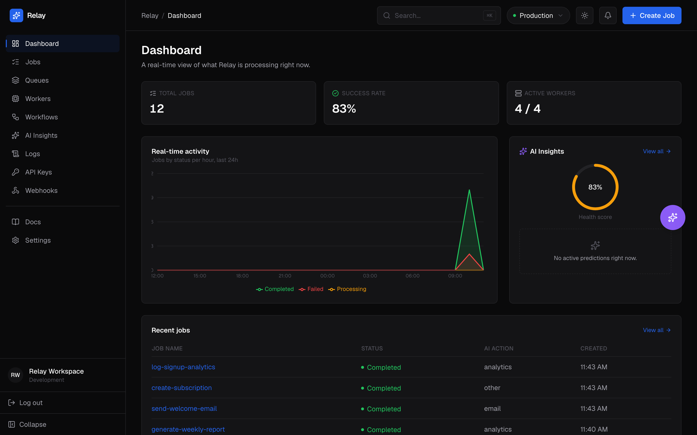
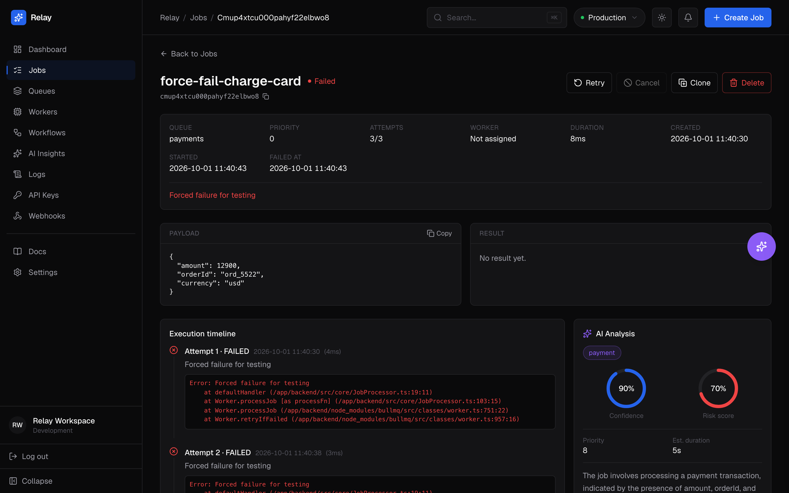
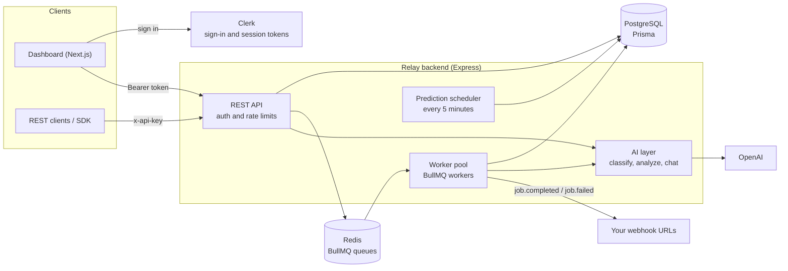

<div align="center">

# Relay

**Background jobs that explain their own failures.**

[](LICENSE)
[!relay](https://img.shields.io/badge/live%20demo-relay--xi--nine--92.vercel.app-2563eb?style=flat-square)](https://relay-xi-nine-92.vercel.app/)
[](#getting-started)
[](#tech-stack)
[](#tech-stack)
[](#tech-stack)
[](#tech-stack)

[Live demo](https://relay-xi-nine-92.vercel.app/) · [Docs](#api--docs) · [Getting started](#getting-started) · [Contributing](CONTRIBUTING.md)

</div>

Relay is an open-source background job queue for Node.js. It runs your jobs on Postgres and Redis, and when one fails, an AI layer returns the **root cause in plain English, a confidence score and a suggested fix** instead of leaving you with a 200-line stack trace. It also classifies jobs, warns you before a queue backs up, and lets you operate it by chatting.

## Relay

Try the hosted app at **[relay-xi-nine-92.vercel.app](https://relay-xi-nine-92.vercel.app/)**: sign up, get your own empty workspace, and create a queue.

<table>
  <tr>
    <td width="50%"></td>
    <td width="50%"></td>
  </tr>
  <tr>
    <td align="center"><sub><b>Dashboard</b> - live activity, health score, error patterns</sub></td>
    <td align="center"><sub><b>Job detail</b> - AI classification and failure analysis on the timeline</sub></td>
  </tr>
</table>

<p align="center">
  
  <br>
  <sub><b>In-app docs</b> - 18 pages with search, available at <code>/docs</code> after you sign in</sub>
</p>

*The screenshots are from a real local run with sample jobs, processed by the real pipeline and the real AI model.*

## Features

**Queueing**
- Queues, jobs and workers behind a REST API, backed by Postgres (source of truth) and Redis/BullMQ (dispatch)
- Automatic retries with exponential backoff, per-job `maxAttempts`, priorities, scheduled jobs, pause/resume
- Per-attempt execution logs with status, duration, error message and stack trace
- Multi-step **workflows**: chain queues into a sequence that advances on its own and halts when a step fails
- Signed **webhooks** for `job.completed` and `job.failed` (HMAC-SHA256)

**AI layer** (optional; jobs run the same without it)
- **Job classification**: category, risk score, priority and estimated duration, stored on the job
- **Error analysis**: root cause, confidence and suggested fix; recurring errors are fingerprinted into patterns with occurrence counts, and confident transient failures are re-queued automatically
- **Predictive monitoring**: flags capacity overload and error-rate surges before they become incidents (rule-based, not an LLM call)
- **Chat agent**: ask about your jobs and queues in plain English; it calls real tools, and destructive actions (cancel a job, pause a queue) wait for your explicit approval
- **Per-workspace usage cap**: 200 AI calls per month with a live counter in Settings; at the cap, AI features pause and jobs keep running

**Platform**
- **Multi-tenant workspaces**: sign in with Clerk and get your own isolated workspace, queues, API keys and limits
- Two auth modes: Clerk session tokens (dashboard) and `x-api-key` (servers and scripts)
- Per-workspace rate limiting, plus a per-IP limiter
- Dashboard with real-time activity, logs, worker stats and AI insights, and an in-app docs site
- TypeScript SDK in [`sdk/typescript`](sdk/typescript) (in the repo, not yet published to npm)

## Tech stack

| Layer | Technology |
|---|---|
| Backend | Node.js, Express 4, TypeScript (strict) |
| Database | PostgreSQL 16, Prisma 5 |
| Queue | Redis 7, BullMQ |
| AI | LangChain + OpenAI (classification, error analysis), Vercel AI SDK + OpenAI (chat agent) |
| Frontend | Next.js 16 (App Router), React 19, Tailwind CSS 4, Recharts |
| Auth | Clerk |
| Hosting | Railway (backend), Vercel (frontend) |

## Architecture



Postgres is the source of truth for jobs; Redis/BullMQ handles fast dispatch, retries and concurrency. AI steps run beside job processing and never block it: an AI outage, a disabled toggle or a reached monthly cap only means a job has no explanation.

## Getting started

### Prerequisites

- **Node.js 20.9 or newer** (required by Next.js 16)
- **Docker** (for local Postgres and Redis)
- A free **[Clerk](https://clerk.com)** application (the dashboard sign-in needs its keys)
- An **OpenAI API key** (optional: everything except the AI features works without one)

### 1. Clone and start Postgres and Redis

```bash
git clone https://github.com/Hrithikdeep/relay.git
cd relay
docker compose up -d
```

This starts Postgres 16 on host port `5435` and Redis 7 on `6379` ([`docker-compose.yml`](docker-compose.yml)).

### 2. Backend

```bash
cd backend
npm install
cp .env.example .env     # then fill in CLERK_SECRET_KEY and, optionally, OPENAI_API_KEY
npm run db:migrate       # applies the Prisma migrations
npm run seed             # optional: a dev workspace with queues and an API key
npm run dev              # API on http://localhost:3001
```

### 3. Frontend

```bash
cd frontend
npm install
cp .env.example .env.local   # then fill in the two Clerk keys
npm run dev                  # dashboard on http://localhost:3000
```

Open <http://localhost:3000>, click **Create workspace**, sign up, and you land on a dashboard for your own empty workspace. Create a queue, post a job, and use a job whose name contains `force-fail` to see a failure get analyzed.

> **Clerk setup note:** leave Organizations off (or not required) in your Clerk application. Relay creates its own workspace per user, and a forced organization step blocks sign-in.

> **Seed data:** `npm run seed` creates a workspace named `test-workspace` with an API key `relay_test_key_123`. It is for local development only and is reachable over the REST API; the dashboard always shows your own signed-in workspace.

### Other scripts

| Where | Command | What it does |
|---|---|---|
| `backend` | `npm run build` / `npm start` | Transpile with esbuild to `dist/`, then run it |
| `backend` | `npm run db:migrate:deploy` | Apply migrations in production |
| `backend` | `npm run db:studio` | Open Prisma Studio |
| `backend` | `npm run db:reset` | Drop and re-create the dev database |
| `frontend` | `npm run build` / `npm start` | Production build and server |
| `frontend` | `npm run lint` | ESLint |
| `sdk/typescript` | `npm run build` | Build the SDK |

### Deploying

The backend runs anywhere Node, Postgres and Redis do (Railway is what Relay itself uses): `npm run build`, `npm run db:migrate:deploy`, `npm start`, with the variables below set. Set `REDIS_URL` if your provider gives you a single connection string.

The frontend deploys to Vercel with **Root Directory set to `frontend`** (this is a monorepo). Set `NEXT_PUBLIC_API_URL` **before** the build, since it is inlined into the bundle.

[](https://vercel.com/new/clone?repository-url=https%3A%2F%2Fgithub.com%2FHrithikdeep%2Frelay&env=NEXT_PUBLIC_API_URL,NEXT_PUBLIC_CLERK_PUBLISHABLE_KEY,CLERK_SECRET_KEY&envDescription=Backend%20URL%20and%20your%20Clerk%20keys&project-name=relay)

## Environment variables

### Backend (`backend/.env`)

Validated at startup by [`src/config/env.ts`](backend/src/config/env.ts). Template: [`backend/.env.example`](backend/.env.example).

| Variable | Required | Default | Description |
|---|---|---|---|
| `DATABASE_URL` | Yes | - | PostgreSQL connection string |
| `JWT_SECRET` | Yes | - | Any non-empty string; required by the schema, not otherwise used today |
| `CLERK_SECRET_KEY` | For sign-in | - | Clerk secret key; without it Bearer-token requests are rejected (API keys still work) |
| `REDIS_URL` | One of these | - | Full Redis connection string; takes precedence over host/port |
| `REDIS_HOST` / `REDIS_PORT` | One of these | `localhost` / `6379` | Redis host and port |
| `OPENAI_API_KEY` | No | - | Enables the AI features; without it they are skipped |
| `OPENAI_MODEL` | No | `gpt-5.6-luna` | Model used for AI features |
| `PORT` | No | `3001` | API port |
| `API_VERSION` | No | `v1` | URL prefix for the API |
| `LOG_LEVEL` | No | `info` | `error`, `warn`, `info` or `debug` |
| `NODE_ENV` | No | `development` | `development`, `production` or `test` |

### Frontend (`frontend/.env.local`)

Template: [`frontend/.env.example`](frontend/.env.example).

| Variable | Required | Description |
|---|---|---|
| `NEXT_PUBLIC_API_URL` | Yes | Backend base URL, without `/v1`. Inlined at build time |
| `NEXT_PUBLIC_CLERK_PUBLISHABLE_KEY` | Yes | Clerk publishable key |
| `CLERK_SECRET_KEY` | Yes | Clerk secret key (used by the Next.js middleware) |
| `DEMO_ACCESS_PASSWORD`, `DEMO_ACCESS_EMAIL`, `DEMO_SHOW_CREDENTIALS` | No | Retired demo password gate; only the legacy `/login` page reads them |

## API & docs

Relay's API is REST under `/v1`. It accepts two credentials: a **Clerk session token** (`Authorization: Bearer ...`, used by the dashboard) and an **API key** (`x-api-key: ...`, created on the API Keys page, for servers and scripts).

```bash
# 1. create a queue
curl -X POST http://localhost:3001/v1/queues \
  -H "x-api-key: YOUR_API_KEY" -H "Content-Type: application/json" \
  -d '{ "name": "emails" }'

# 2. create a job on it
curl -X POST http://localhost:3001/v1/jobs \
  -H "x-api-key: YOUR_API_KEY" -H "Content-Type: application/json" \
  -d '{ "queueId": "YOUR_QUEUE_ID", "name": "send-welcome-email", "payload": { "to": "user@example.com" } }'
```

Full documentation lives in the app at **[/docs](https://relay-xi-nine-92.vercel.app/docs)** (sign in first): quick start, authentication and rate limits, queues, jobs, workers and workflows, the AI layer, a reference for every endpoint, and the SDKs. The source is under [`frontend/src/app/(app)/docs`](<frontend/src/app/(app)/docs>).

## Project structure

```
relay/
├── backend/             Express API, Prisma schema and migrations, BullMQ worker pool, AI layer
│   ├── src/api/         routes and auth / rate-limit middleware
│   ├── src/core/        job processing and the workflow engine
│   ├── src/ai/          classifier, error analyzer, predictor, chat agent
│   ├── prisma/          schema, migrations, seed script
│   └── scripts/         build script and the cross-tenant leak test
├── frontend/            Next.js dashboard, landing page and in-app docs
├── sdk/typescript/      @relay/sdk (not yet published)
├── screenshots/         images used in this README
└── docker-compose.yml   local Postgres and Redis
```

## Contributing

Issues and pull requests are welcome. See **[CONTRIBUTING.md](CONTRIBUTING.md)** for the dev setup, the checks to run before a PR, and conventions.

## Roadmap

Planned next:
- Team, billing, integrations and security settings (placeholder tabs in Settings today)
- Publish `@relay/sdk` to npm
- A visual drag-and-drop workflow builder (the builder today is list-based; the execution engine is complete)
- Expose the AI chat agent through the SDK (in-app only today)

Current limitations, stated plainly:
- **Job handlers run inside the Relay server.** With no handler registered for a job name, a job completes by echoing its payload as the result (and names containing `force-fail` fail on purpose, for trying retries and AI analysis). Custom handlers are registered in backend code; Relay does not hand jobs to external worker processes over the API.
- **No automated test suite yet.** The `backend/tests` folders are empty; [`backend/scripts/leak-test.ts`](backend/scripts/leak-test.ts) is a cross-tenant isolation check you can run against a local backend.
- **Backend type-check is slow.** `npm run typecheck` currently runs out of memory on the AI chat files; production builds use esbuild, which only strips types.

## License

Relay is released under the [MIT License](LICENSE).

## Built by

Built by [Hrithik Deep](https://github.com/Hrithikdeep) · [Live site](https://relay-xi-nine-92.vercel.app/)
